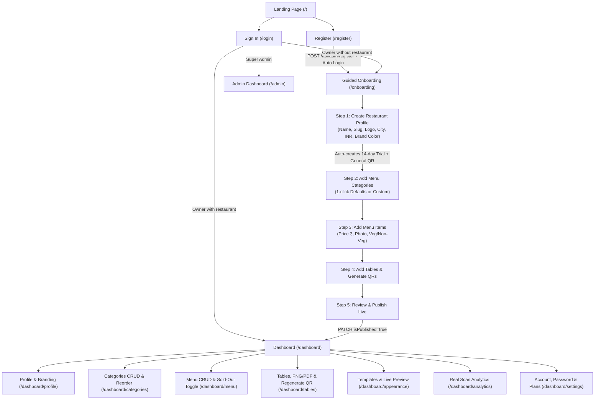
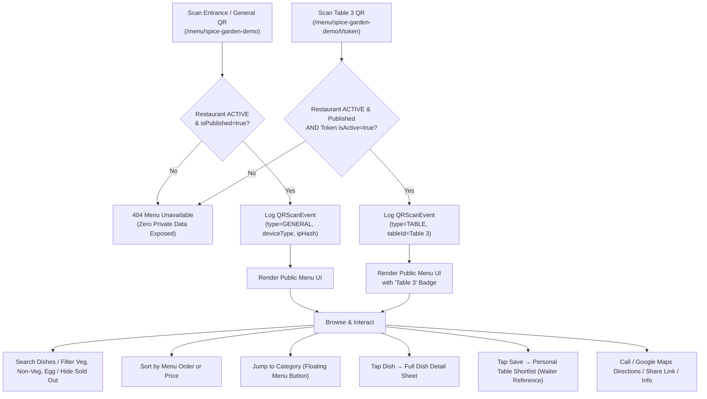
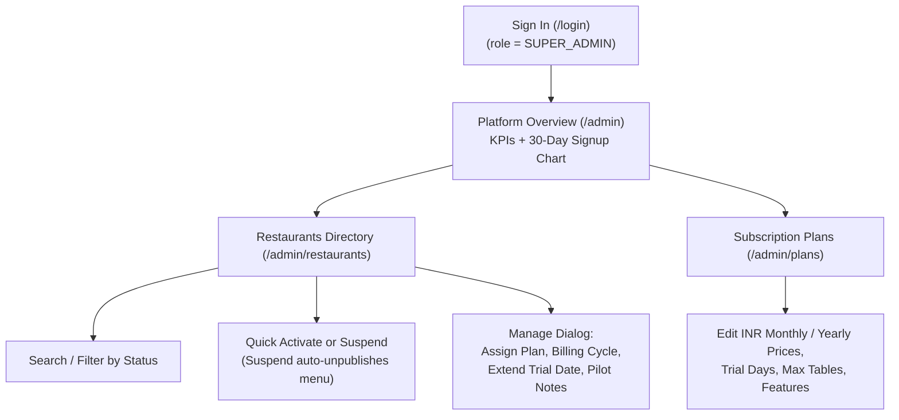

# MenuQR — User Flows

Complete end-to-end journeys for all three user roles (**Restaurant Owner**, **Customer / Diner**, and **Super Admin**), mapped directly to the live routes and source files in this codebase.

---

## 1. Restaurant Owner Flow (Signup → Onboarding → Daily Management)

### Key Owner Journeys & Source Files

| Journey | Route | API Endpoints | Source File |
| --- | --- | --- | --- |
| Account signup | `/register` | `POST /api/auth/register`, Auth.js credentials | `src/app/register/page.tsx` |
| Account sign in | `/login` | Auth.js `/api/auth/callback/credentials` | `src/app/login/page.tsx` |
| 5-step onboarding | `/onboarding` | `/api/restaurants`, `/api/categories`, `/api/menu-items`, `/api/tables`, `/api/restaurants/current` | `src/app/onboarding/page.tsx` |
| Publish / Unpublish menu | `/dashboard` | `PATCH /api/restaurants/current` | `src/app/dashboard/page.tsx` |
| Edit price or mark Sold Out | `/dashboard/menu` | `PATCH /api/menu-items/[id]` | `src/app/dashboard/menu/page.tsx` |
| Upload dish/logo photo | `/dashboard/menu`, `/dashboard/profile` | `POST /api/upload` | `src/components/ui/image-upload.tsx` |
| Print table QR cards | `/dashboard/tables` | `GET /api/qr-codes/[id]/download?format=png\|pdf`, `GET /api/qr-codes/bulk-pdf` | `src/app/dashboard/tables/page.tsx` |
| Invalidate & regenerate QR | `/dashboard/tables` | `POST /api/qr-codes/[id]/regenerate` | `src/app/api/qr-codes/[id]/regenerate/route.ts` |
| Switch template & color | `/dashboard/appearance` | `PATCH /api/restaurants/current` | `src/app/dashboard/appearance/page.tsx` |
| Check real scan trends | `/dashboard/analytics` | `GET /api/analytics?days=7\|14\|30` | `src/app/dashboard/analytics/page.tsx` |

---

## 2. Customer / Diner Flow (Scan QR → Browse Menu)

Zero login, zero app installation, instant SSR load.

### Edge Cases Handled
- **Price or Sold-Out Changed**: Customer refreshes or re-scans the **exact same QR code** and immediately sees the updated price or `Sold Out` badge (menu data is never embedded inside the QR).
- **QR Regenerated**: Old printed QR token is marked `isActive = false` and immediately returns `404 Menu Unavailable`.
- **Restaurant Suspended or Draft**: Both `/menu/[slug]` and `/api/public/menu/[slug]` return `404` with zero dish leakage.

---

## 3. Super Admin Flow (Platform Oversight & Pilot Management)

### Security Gate
- Non-admin users visiting `/admin/*` are redirected to `/dashboard` by `src/middleware.ts` and `src/app/admin/layout.tsx`.
- Any owner calling `/api/admin/*` receives `403 Forbidden` from `requireSuperAdmin()` in `src/lib/tenant.ts`.

---

## 4. What Happens When You Update Something?

| If you update... | Immediate effect in the app |
| --- | --- |
| A dish price or availability in `/dashboard/menu` | Public menu (`/menu/[slug]`) reflects it immediately on next load; no QR reprint needed. |
| Template (`MODERN` / `CLASSIC` / `MINIMAL`) or Brand Color in `/dashboard/appearance` | Public menu theme, category pills, table badge, and newly downloaded printable QR PDFs adopt the new styling immediately. |
| Restaurant slug in `/dashboard/profile` | Public URL changes to `/menu/<new-slug>`; re-download QR codes from `/dashboard/tables`. |
| Table QR regenerated in `/dashboard/tables` | Old table QR URL returns `404`; new table QR URL works immediately while preserving past scan counts. |
| Restaurant suspended in `/admin/restaurants` | Public menu & table QRs immediately return `404`, and owner cannot re-publish until reactivated. |
